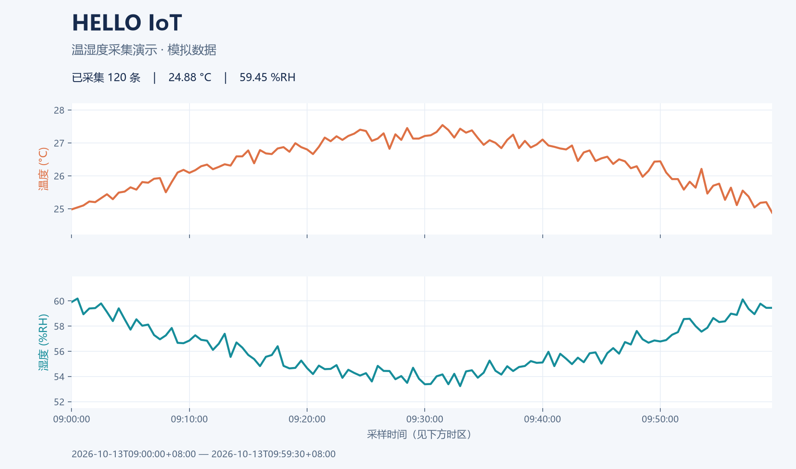

# Hello IoT · 温湿度采集演示

我的第一个物联网项目：从能运行的模拟采集开始，逐步接入 ESP32、DHT11、MQTT 和网页展示。

**当前版本使用程序生成的模拟数据，无须硬件。** 可以一次生成曲线，也可以打开窗口逐条回放；每次运行都会输出 CSV 记录、PNG 曲线和 JSON 统计摘要。



图中数据由固定种子生成，不是实测温湿度。示例从北京时间 2026-10-13 09:00:00 开始，120 条记录，每条间隔 30 秒。

## 快速开始（Windows / PowerShell）

需要 Python 3.10 或更新版本，以及 matplotlib。先下载本项目，打开 PowerShell 并进入项目目录。

### 方式一：启动脚本

脚本会使用 `%USERPROFILE%/AppData/Local/Programs/Python/Python313/python.exe` 对应的解释器绝对路径，并把运行配置放在项目的 `.runtime` 目录。也可以通过 `-解释器 "你的解释器绝对路径"` 指定其他安装位置。

```powershell
# 一次生成 120 条模拟记录，通常数秒内完成
./启动演示.ps1

# 打开曲线窗口，每 0.3 秒回放一条，共 30 条
./启动演示.ps1 -实时 -样本数 30
```

运行完毕后，打开 `运行结果/温湿度曲线.png` 查看结果。实时模式完成后会关闭窗口，结果图片仍会保存。

### 方式二：直接使用解释器绝对路径

如果脚本受到 PowerShell 执行策略限制，或 Python 装在别处，可以直接运行以下命令。把 `$demoPython` 改成你自己的解释器绝对路径。

```powershell
$demoPython = Join-Path ([Environment]::GetFolderPath([Environment+SpecialFolder]::UserProfile)) "AppData/Local/Programs/Python/Python313/python.exe"
$env:PYTHONIOENCODING = "utf-8"

# 仅在尚未安装 matplotlib 时执行
& $demoPython -m pip install -r requirements.txt

# 一次生成全部数据
& $demoPython -m iot_demo

# 逐条回放数据
& $demoPython -m iot_demo --live --samples 30 --refresh 0.3
```

程序默认将 matplotlib 缓存写入项目的 `.runtime/matplotlib`，也会尊重已有的 `MPLCONFIGDIR` 设置。

## 会得到哪些文件

| 文件 | 用途 |
| --- | --- |
| `运行结果/温湿度记录.csv` | 每行一个采样点，包含带时区的时间、温度、湿度和来源；可用 Excel 打开 |
| `运行结果/温湿度曲线.png` | 温度、湿度分开画图，并标出最新读数 |
| `运行结果/统计摘要.json` | 记录数量、是否完成、起止时间、最小值、最大值、均值、最新值 |

CSV 字段为 `timestamp,temperature_c,humidity_pct,source`；来源固定为 `simulated`。温度单位为 °C，湿度单位为 %RH（相对湿度百分比）。

**重复使用同一个输出目录，会覆盖这三个文件。** 想保留不同实验，请用 `--output` 指定不同目录。

## 试着改几个参数

```powershell
# 复现 README 中的示例
& $demoPython -m iot_demo --samples 120 --interval 30 --seed 42 --start "2026-10-13T09:00:00+08:00" --output "我的实验/固定种子"

# 比较另一组模拟噪声
& $demoPython -m iot_demo --seed 7 --output "我的实验/另一组数据"

# 查看全部参数
& $demoPython -m iot_demo --help
```

| 参数 | 默认值 | 含义 |
| --- | --- | --- |
| `--samples` | 120 | 生成多少条记录，至少为 1 |
| `--interval` | 30 | 数据里的采样间隔，单位秒 |
| `--seed` | 42 | 随机种子；参数相同时数据可复现 |
| `--start` | 当前北京时间 | ISO 格式的开始时间；不写时区时按 UTC+8 处理 |
| `--output` | `运行结果` | 保存结果的目录 |
| `--live` | 关闭 | 打开窗口逐条回放 |
| `--refresh` | 0.3 | 窗口回放时每帧等待秒数，只影响实时模式 |

`--interval` 与 `--refresh` 是两件事：例如模拟时间每条前进 30 秒，窗口实际每 0.3 秒显示一条。**实时模式展示的是模拟数据回放，不是实时测量。**

窗口关闭或按 Ctrl+C 时，已经写入的 CSV 记录会保留，并生成对应曲线、摘要；`complete` 会显示是否已采满。若一条也未采集到，会提示重新运行，只留下 CSV 表头。

## 项目结构

```text
hello-iot/
├── iot_demo/
│   ├── sensor.py            # 模拟读数、写 CSV、计算统计
│   └── __main__.py          # 命令行入口、画图、实时回放
├── tests/test_sensor.py     # 采样、导出和提前停止的测试
├── docs/
│   ├── 开发笔记.md
│   └── 演示结果/            # 可复现的示例数据与曲线
├── 启动演示.ps1
├── requirements.txt
└── .github/workflows/检查.yml
```

模块只分成两层：数据采集与导出、命令行与可视化。以后接串口时，可以新增一个产生 `Reading` 的数据源，继续使用同一套 CSV 和统计逻辑。

## 运行检查

```powershell
& $demoPython -m unittest discover -s tests -v
& $demoPython -m iot_demo --samples 1 --output "运行结果/单样本"
```

GitHub Actions 会在 Python 3.11、3.13 上运行测试，再实际生成一组演示文件。没有图形窗口的环境可以运行默认模式；`--live` 需要可用的桌面图形后端。

## 学习路线

- [x] 实现无须硬件的温湿度模拟采集
- [x] CSV 导出、曲线绘图、统计摘要
- [x] 实时回放与提前停止后的数据保留
- [x] 自动化测试与 GitHub Actions 工作流
- [ ] 通过分支和 PR 练习 Git 协作流程
- [ ] 接入 ESP32 + DHT11 的真实读数
- [ ] 串口通信（Python pyserial）
- [ ] MQTT 上云
- [ ] 网页展示数据

## 计划硬件与开发环境

- 主控：ESP32
- 传感器：DHT11 温湿度模块
- 硬件开发工具：Arduino IDE
- 数据处理：Python / matplotlib
- 版本控制：Git + GitHub

硬件阶段再准备设备；当前演示不需要 pyserial、MQTT 服务或联网。

开发过程与小练习见 [开发笔记](docs/开发笔记.md)，本机运行结果见 [验证记录](docs/验证记录.md)。

> 开始时间：2026-09-10 · 大二物联网工程专业
